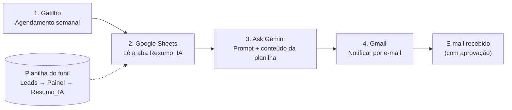
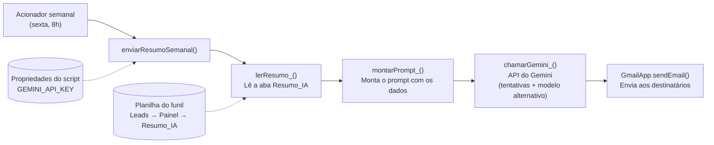

# Resumo Semanal Inteligente do Comercial

Automação com IA Generativa (Gemini) integrada ao Google Workspace que lê o funil de vendas de uma pequena empresa e envia ao diretor, toda sexta-feira de manhã, um e-mail curto com o andamento dos atendimentos da equipe comercial.

O projeto foi construído em **duas versões**: a primeira no **Google Workspace Studio**, e a segunda em **Google Apps Script**, criada para eliminar a aprovação manual que o Studio exigia a cada execução.

**Projeto final do curso de IA Generativa**

| | |
|---|---|
| **Alunos (dupla)** | [Kamilla Aires do Nascimento e Leonardo Azevedo Araujo] |
| **email** | kamillaairesdonascimento@gmail.com , dispositivoleo@gmail.com |
| **Curso / turma** | Geração Tech 4.0 (ONLINE) |
| **Data de entrega** | [20/11/26] |
| **Tema** | Tema livre, alinhado à opção 3 (Workflow nativo no Google Workspace) |
| **Ferramentas** | Google Sheets, Gemini, Gmail, Google Workspace Studio (versão 1), Google Apps Script e Google AI Studio (versão 2) |

---

## Sumário

1. [Descrição do problema](#1-descrição-do-problema)
2. [Alinhamento com o tema do curso](#2-alinhamento-com-o-tema-do-curso)
3. [Arquitetura da solução](#3-arquitetura-da-solução)
4. [Base de dados: a aba Resumo_IA](#4-base-de-dados-a-aba-resumo_ia)
5. [Engenharia de prompts](#5-engenharia-de-prompts)
6. [Testes e iterações](#6-testes-e-iterações)
7. [Demonstração (registros visuais)](#7-demonstração-registros-visuais)
8. [Artefato técnico (export do workflow)](#8-artefato-técnico-export-do-workflow)
9. [Como reproduzir a versão 2](#9-como-reproduzir-a-versão-2)
10. [Limitações e melhorias futuras](#10-limitações-e-melhorias-futuras)
11. [Estrutura do repositório](#11-estrutura-do-repositório)

---

## 1. Descrição do problema

**Cenário simulado:** criamos a situação fictícia em que uma pequena empresa cujo setor comercial registra todos os contatos com potenciais clientes (leads) em uma planilha do Google Sheets. A planilha tem uma aba de dados (`Leads`, uma linha por lead, com origem, fase do funil, datas de contato e de próximo follow-up, motivo de perda etc.) e uma aba de consolidação numérica (`Painel`).

**A dor:**

- O diretor precisa acompanhar o andamento do comercial, mas não tem tempo de abrir a planilha, ler dezenas de números e interpretar o que importa.
- Os números do Painel dizem *quanto*, mas não dizem *o que fazer*: faltam destaque dos riscos, pontos positivos e prioridades.
- Follow-ups atrasados e leads sem retorno passam despercebidos até virarem perdas.
- A leitura manual depende de alguém lembrar de fazê-la, e o resultado varia a cada semana.

**A solução:** um fluxo automático que, toda sexta-feira de manhã, lê os indicadores atualizados da planilha, usa o Gemini para transformá-los em um resumo executivo (o que aconteceu, o que exige atenção, o que está funcionando e ações para a semana seguinte) e entrega o resultado por e-mail.

**Resultado esperado:** o diretor recebe, sem pedir, uma leitura de menos de um minuto sobre o comercial, com números verificáveis e ações práticas, e pode agir antes que os leads esfriem.

---

## 2. Alinhamento com o tema do curso

O projeto é uma **proposta de tema livre**, construída sobre a estrutura da **opção 3 (Workflow nativo no Google Workspace)**:

| Elemento da opção 3 | Neste projeto |
|---|---|
| Fluxo nativo, sem ferramentas externas de automação | Versão 1 no Workspace Studio; versão 2 em Apps Script, a plataforma de automação do próprio Workspace |
| Alimentação do Google Sheets | A planilha é alimentada pelo setor comercial; a aba `Resumo_IA` consolida os indicadores por fórmula |
| Processamento/resumo textual com IA | O Gemini interpreta os indicadores e redige o resumo |
| Disparo de e-mail formatado | O Gmail entrega o relatório aos destinatários |

A diferença em relação ao tema 3 é a origem do gatilho: em vez de uma resposta de Google Forms, o fluxo é disparado por **agendamento semanal**.

Conteúdos do curso aplicados: [Engenharia de prompt, estruturação de saída, uso de LLM em fluxos de automação, integração com Google Workspace].

---

## 3. Arquitetura da solução

### 3.1 Duas versões, um mesmo objetivo

| | **Versão 1: Workspace Studio** | **Versão 2: Apps Script** |
|---|---|---|
| Plataforma | Google Workspace Studio (sem código) | Google Apps Script (JavaScript), vinculado à planilha |
| Acesso ao Gemini | Passo nativo *Ask Gemini* | API do Gemini, chamada pelo script com chave de API |
| Envio do e-mail | Passo *Notificar-me por e-mail* (envia à conta dona do fluxo) | `GmailApp`, com lista configurável de destinatários |
| Aprovação | Tela de aprovação exibida na execução | Autorização única na primeira execução; depois roda sozinho |
| Resultado | Funcional, com intervenção manual no envio | Funcional e 100% automático |

A versão 1 validou a ideia e o prompt, porém, encontramos o impedimento que é a necessidade de autorizar manualmente sempre que o flow fosse executado. A versão 2 foi criada para tornar a automação realmente autônoma.

### 3.2 Versão 1: fluxo no Workspace Studio



| # | Etapa (Studio) | O que faz | Saída |
|---|---|---|---|
| 1 | **Gatilho: agendamento** | Dispara o fluxo toda sexta-feira de manhã | Início da execução |
| 2 | **Sheets: obter conteúdo da planilha** | Lê as linhas da aba `Resumo_IA` (Indicador, Valor, Observação) | Conteúdo da aba, disponível como variável |
| 3 | **Ask Gemini** | Interpreta os indicadores e redige o resumo, seguindo as regras do prompt | Texto do resumo executivo |
| 4 | **Gmail: notificar por e-mail** | Monta o e-mail com assunto fixo, o resumo e a assinatura padrão | E-mail enviado, após aprovação |

### 3.3 Versão 2: fluxo em Apps Script



| Função | Responsabilidade | Entrada → Saída |
|---|---|---|
| `criarGatilhoSemanal()` | Cria o acionador baseado em tempo (executada uma única vez) | Configuração (`DIA`, `HORA`) → acionador semanal |
| `enviarResumoSemanal()` | Orquestra todo o fluxo | Acionador → e-mail enviado |
| `lerResumo_()` | Lê a aba `Resumo_IA` e converte cada linha em texto | Planilha → linhas `Indicador: Valor (Observação)` |
| `montarPrompt_(dados)` | Insere os dados no prompt | Texto dos indicadores → prompt completo |
| `chamarGemini_(prompt, chave)` | Chama a API do Gemini com tentativas automáticas e modelo alternativo | Prompt → texto do resumo |

### 3.4 Decisões de arquitetura

- **Os números são calculados na planilha, não pelo LLM.** As fórmulas do Sheets fazem toda a contagem e o Gemini só interpreta e redige. Isso reduz o risco de o modelo errar contas ou inventar valores.
- **Uma aba dedicada (`Resumo_IA`)** em formato plano (Indicador, Valor, Observação) isola a camada de IA da estrutura interna do Painel.
- **Nenhum dado pessoal chega ao modelo.** A aba `Resumo_IA` contém apenas dados agregados (contagens, taxas, custos), sem nomes ou telefones de clientes.
- **Fecho do e-mail como texto fixo**, para que a assinatura seja idêntica em toda execução e não dependa do modelo.
- **Robustez na chamada ao modelo (versão 2):** até 3 tentativas por modelo, com espera progressiva, e um modelo alternativo caso o principal esteja indisponível. Erros permanentes (como chave inválida) interrompem a execução imediatamente, sem repetições inúteis.
- **Segredos fora do código:** a chave de API fica nas Propriedades do script, nunca no código-fonte nem neste repositório.
- **Destinatários configuráveis** em uma lista no início do código, o que permite incluir mais pessoas sem alterar a lógica.

---

## 4. Base de dados: a aba Resumo_IA

A aba `Resumo_IA` tem três colunas e cerca de 40 linhas. Todos os valores são fórmulas que apontam para o `Painel` ou para a aba `Leads`; nada é digitado manualmente.

| Coluna | Conteúdo |
|---|---|
| A: Indicador | Nome do indicador (alguns são fórmulas, para acompanhar renomeações de fases e origens) |
| B: Valor | Número, percentual, data ou valor em reais |
| C: Observação | Contexto curto (por exemplo, participação da fase no total) |

Na versão 2, o script converte cada linha da aba em uma linha de texto, no formato:

```
Total de leads (famílias): 145 (Todos os contatos registrados na aba Leads)
Alunos matriculados: 7 (Conta alunos, não famílias)
Follow-ups atrasados: 27 (Leads com próximo contato vencido)
```

> Os dados usados na demonstração são **fictícios**, criados para este projeto.

---

## 5. Engenharia de prompts

O mesmo prompt é usado nas duas versões. Ele é organizado em cinco blocos: papel, dados, regras, estrutura de saída e (fora do modelo) fecho fixo.

### 5.1 Prompt final

```text
PAPEL
Você é o assistente de gestão comercial de uma pequena empresa.
Toda sexta-feira de manhã, você prepara para o diretor um e-mail
curto com o andamento dos atendimentos da equipe comercial na semana.

DADOS (use somente estes dados)
Abaixo está o conteúdo da planilha de resumo do funil de vendas.
Cada linha tem: Indicador, Valor e Observação.

{{dados da aba Resumo_IA}}

REGRAS
1. Nunca invente números, nomes ou fatos. Se um dado não estiver
   na planilha, diga que não está disponível.
2. Não cite nomes ou dados pessoais de clientes.
3. Não repita todos os números: destaque o que importa para uma
   decisão do diretor.
4. Tom: profissional, direto e cordial, sem jargão.
5. Máximo de 200 palavras, em português do Brasil, em texto simples
   (sem tabelas e sem símbolos de formatação como # ou **).
6. Se algum indicador estiver vazio ou indisponível, simplesmente
   não o mencione. Nunca cite erros, falhas ou problemas técnicos.

ESTRUTURA
1. Saudação ao diretor (1 frase).
2. Resumo da semana: 2 ou 3 frases com os números principais
   (total de leads, novos, em andamento, matrículas, taxa).
3. Ponto de atenção: o principal risco (ex.: follow-ups atrasados,
   perdas por motivo, origem de leads com baixa conversão).
4. Destaque positivo: 1 frase sobre o que está funcionando.
5. Ações sugeridas para a próxima semana: 2 ou 3 itens práticos.
   As ações devem ser específicas e ter um número ou um alvo, por
   exemplo "Retomar contato com os N follow-ups atrasados até
   quarta-feira".
6. Não escreva despedida, assinatura nem frases como "fico à
   disposição". Termine o texto na última ação sugerida.
```
### 5.2 Instruções do sistema, contexto e variáveis

| Componente | Onde aparece no prompt | Função |
|---|---|---|
| **Instrução de sistema (papel)** | Bloco PAPEL | Define quem o modelo é, para quem escreve e com que frequência |
| **Contexto** | Bloco DADOS | Informa de onde vêm os dados e qual é a estrutura das linhas |
| **Variável** | `{{dados da aba Resumo_IA}}` | Versão 1: variável inserida pelo menu *+ Variáveis* do Studio. Versão 2: texto montado por `lerResumo_()` e inserido por `montarPrompt_()` (`${dados}`) |
| **Restrições** | Bloco REGRAS | Evita invenção de dados, protege dados pessoais, controla tom, tamanho e formato |
| **Formato de saída** | Bloco ESTRUTURA | Garante um e-mail com a mesma organização em toda semana |

### 5.3 Montagem do e-mail

| Campo | Conteúdo |
|---|---|
| Assunto | `Resumo semanal do comercial` |
| Corpo | Texto gerado pelo Gemini, seguido de duas linhas fixas: `Atenciosamente,` e `Assistente de Gestão Comercial (relatório automático)` |
| Destinatários | Versão 1: conta dona do fluxo. Versão 2: lista configurável (`DESTINATARIOS`) |

## 6. Testes e iterações

### 6.1 Conferência dos números

O e-mail do primeiro teste foi comparado com a aba `Resumo_IA` e com o `Painel`:

| Indicador | Planilha | E-mail | Confere? |
|---|---|---|---|
| Total de leads | 145 | 145 | Sim |
| Leads em andamento | 36 | 36 | Sim |
| Alunos matriculados | 7 | 7 | Sim |
| Taxa de matrícula | 4,8% | 4,8% | Sim |
| Follow-ups atrasados | 27 | 27 | Sim |
| Novos leads | (erro na célula) | "indisponível" | Não, ver iteração 2 |

### 6.2 Histórico de iterações

**Versão 1 (Workspace Studio)**

| # | Problema observado | Causa | Correção |
|---|---|---|---|
| 1 | O passo de leitura da planilha não mostrava nenhuma variável | As variáveis do Studio não aparecem no cartão do passo; ficam no menu *+ Variáveis* dos campos de texto dos passos seguintes | Variável inserida no prompt pelo menu *+ Variáveis* |
| 2 | O e-mail dizia que o indicador de novos leads estava indisponível "devido a um erro no sistema" | A fórmula de novos leads retornou erro na planilha, e o modelo comunicou isso ao diretor | Fórmula reescrita para os últimos 7 dias; nova regra no prompt (item 6 de REGRAS): não mencionar indicadores indisponíveis nem erros técnicos |
| 3 | Ações sugeridas genéricas (por exemplo, "definir a data para o follow-up pendente") | O prompt não exigia especificidade | Item 5 da ESTRUTURA passou a exigir ações com número ou alvo |
| 4 | O e-mail terminava com um fecho com pontuação incorreta e sem assinatura | O modelo improvisava a despedida | Despedida removida do prompt (item 6 da ESTRUTURA); fecho passou a ser texto fixo no passo do Gmail |
| 5 | O envio exigia aprovação manual a cada execução | Controle de segurança do Studio para passos que compartilham dados | Criação da versão 2 em Apps Script (ver [seção 3.1](#31-duas-versões-um-mesmo-objetivo)) |

**Versão 2 (Apps Script)**

No primeiro teste da versão 2, a execução falhou com o **erro 503 (`UNAVAILABLE`)** devolvido pela API do Gemini, com a mensagem de que o modelo estava com alta demanda. O erro aparece em dois registros: no **log de execução do Apps Script** e no **log da API no Google AI Studio** (prints 12 e 14 da [seção 7](#7-demonstração-registros-visuais)).

| Aspecto | Detalhe |
|---|---|
| **Sintoma** | Execução interrompida com `Erro do Gemini (503)` na função `chamarGemini_` |
| **Diagnóstico** | O 503 indica indisponibilidade temporária do modelo, e não falha do código ou da chave: a requisição chegou ao Gemini, o que também confirmou que a leitura da planilha, a montagem do prompt e a autenticação funcionavam |
| **Risco para a automação** | Em um envio agendado, uma falha momentânea faria o diretor ficar sem o relatório da semana |
| **Correção** | `chamarGemini_` passou a tentar até 3 vezes por modelo, esperando 5 s, 10 s e 15 s entre as tentativas, e a recorrer a um modelo alternativo (`gemini-flash-lite-latest`) se o principal continuar indisponível. Códigos temporários (429, 500, 503, 504) disparam nova tentativa; códigos permanentes interrompem a execução com a mensagem original; 404 passa para o próximo modelo |
| **Resultado** | Novo teste concluído com sucesso, com o e-mail entregue |

### 6.3 Teste final

17/11/26 - Execução concluída; e-mail recebido pelos destinatários; acionador semanal criado e visível no menu Acionadores.

---

## 7. Demonstração (registros visuais)

Os prints abaixo mostram o fluxo configurado e o resultado da execução. Todos os dados são fictícios.

### 7.1 Versão 1: Workspace Studio

| # | Registro | Descrição |
|---|---|---|
| 1 |  | Visão geral do fluxo no Workspace Studio, com os quatro passos em sequência |
| 2 |  | Gatilho de agendamento: frequência semanal, dia, horário e fuso |
| 3 |  | Passo do Sheets apontando para a planilha do funil e a aba `Resumo_IA` |
| 4 |  | Passo Ask Gemini com o prompt e a variável inserida pelo menu *+ Variáveis* |
| 5 |  | Passo do Gmail: assunto, mensagem com a resposta do Gemini e fecho fixo |
| 6 |  | Tela de aprovação exibida na execução |
| 7 |  | Resultado do teste: passos concluídos com sucesso |
| 8 |  | E-mail recebido no primeiro teste (com a falha de novos leads) |
| 9 |  | E-mail recebido na versão final do Studio |
| 10 |  | Aba `Resumo_IA` com os indicadores que alimentam o fluxo |
| 11 |  | Fluxo ativado |

### 7.2 Versão 2: Apps Script

| # | Registro | Descrição |
|---|---|---|
| 12 |  | Registro de execução do Apps Script mostrando o erro 503 (`UNAVAILABLE`) devolvido pelo Gemini, em `chamarGemini_` |
| 13 |  | Tela do Google AI Studio onde a chave de API é criada (chave ocultada) |
| 14 |  | Log de requisições da API no AI Studio, com a mesma falha 503 registrada |
| 15 |  | Registro de execução concluída após a correção  |

---

## 8. Artefato técnico (export do workflow)

- **Versão 2 (Apps Script):** o artefato técnico é o arquivo [`codigo/Codigo.gs`](codigo/Codigo.gs), que contém todo o fluxo e pode ser colado em um projeto de Apps Script vinculado à planilha. Os e-mails dos destinatários estão substituídos por exemplos, e a chave de API não faz parte do código.
- **Versão 1 (Workspace Studio):** o Studio não oferece um arquivo de exportação equivalente ao JSON do n8n. O registro do fluxo é feito pela descrição passo a passo da [seção 3.2](#32-versão-1-fluxo-no-workspace-studio), pelo [prompt completo](#51-prompt-final) e pelos [prints](#71-versão-1-workspace-studio).

---

## 9. Como reproduzir a versão 2

1. **Preparar a planilha.** Tenha, em uma planilha do Google Sheets, as abas `Leads`, `Painel` e `Resumo_IA` (ver [seção 4](#4-base-de-dados-a-aba-resumo_ia)). Também disponibilizaremos uma planilha de exemplo neste respositório.
2. **Criar o projeto de script.** Na planilha, abra *Extensões → Apps Script* (o script precisa estar vinculado à planilha) e cole o conteúdo de [`codigo/Codigo.gs`](codigo/Codigo.gs).
3. **Configurar os destinatários.** Em `CONFIG.DESTINATARIOS`, informe os e-mails que devem receber o relatório.
4. **Criar a chave de API.** No [Google AI Studio](https://aistudio.google.com/apikey), gere uma chave de API do Gemini.
5. **Guardar a chave.** Em *Configurações do projeto → Propriedades do script*, crie a propriedade `GEMINI_API_KEY` com o valor da chave.
6. **Testar.** Execute `enviarResumoSemanal` e autorize as permissões solicitadas (acesso à planilha, envio de e-mail e acesso a serviço externo). Em contas pessoais, o Google exibe o aviso de aplicativo não verificado; use *Avançado → Acessar*.
7. **Agendar.** Execute `criarGatilhoSemanal` uma vez e confira, no menu *Acionadores*, o acionador semanal.

---

## 10. Limitações e melhorias futuras

**Limitações**

- **Aprovação no Workspace Studio (versão 1):** o passo de envio exigiu aprovação manual a cada execução, e a tela exibida não oferecia uma opção de aprovação permanente. Foi o motivo da criação da versão 2.
- **Dependência de API externa (versão 2):** o script depende da disponibilidade da API do Gemini e de uma chave de API. As tentativas automáticas e o modelo alternativo reduzem o risco, mas não o eliminam.
- **Nomes de modelos:** os nomes usados (`gemini-flash-latest` e `gemini-flash-lite-latest`) são apelidos que apontam para versões atuais dos modelos e podem mudar com o tempo; é preciso revisá-los periodicamente.
- **Variação do modelo:** o texto gerado pode variar um pouco entre execuções, mesmo com o mesmo prompt. Os números continuam corretos porque vêm da planilha, mas o estilo pode mudar.
- **Horário do envio:** o acionador de Apps Script dispara dentro de uma janela de uma hora (por exemplo, entre 8h e 9h), e não em um minuto exato.
- **Dependência da planilha:** o fluxo só é tão bom quanto o preenchimento do setor comercial. Datas ausentes ou fases incorretas distorcem os indicadores.
- **Privacidade:** a planilha real de uma empresa contém dados pessoais. A aba `Resumo_IA` foi desenhada para enviar ao modelo apenas dados agregados, e os dados do projeto são fictícios. Ao usar a API gratuita do Gemini, é preciso verificar os termos de uso de dados da versão gratuita.
- **Comparação semanal:** o relatório mostra a situação atual, sem comparar automaticamente com a semana anterior.
- **Cotas:** contas do Gmail e do Apps Script têm limites diários de e-mails e de execuções, suficientes para este uso (um envio por semana), mas relevantes em escala.

**Melhorias futuras**

- Aba `Historico`, alimentada semanalmente, para comparar indicadores com a semana anterior.
- Aviso automático por e-mail ou Google Chat quando a execução falhar mesmo após as tentativas.

---

## 11. Estrutura do repositório

```
resumo-semanal-comercial/
├── README.md                  (esta documentação)
├── codigo/
│   └── Codigo.gs              (script da versão 2, sem e-mails nem chave de API)
├── prints/                    (registros visuais, numerados na ordem do fluxo)
│   ├── aba-resumo-ia.png
│   ├── ai-studio-chave-api.png
│   ├── ai-studio-log-api-erro-503.png
│   ├── appsscript-execucao-sucesso.png
│   ├── appsscript-log-erro-503.png
│   ├── aprovacao.png
│   ├── config-email.png
│   ├── email-final.png
│   ├── email-v1.png
│   ├── fluxo-ativado.png
│   ├── fluxo-completo1.png
│   ├── gatilho.png
│   ├── leitura-planilha.png
│   ├── prompt-gemini.png
│   └── resultado-testes.png
├── exemplos/
│   ├── email-v1.txt
│   └── email-final.txt
│
└── planilha (planilha para uso em testes)
    └──planilha_exemplo.
---

*Projeto desenvolvido para fins acadêmicos. Todos os dados exibidos são fictícios.*
